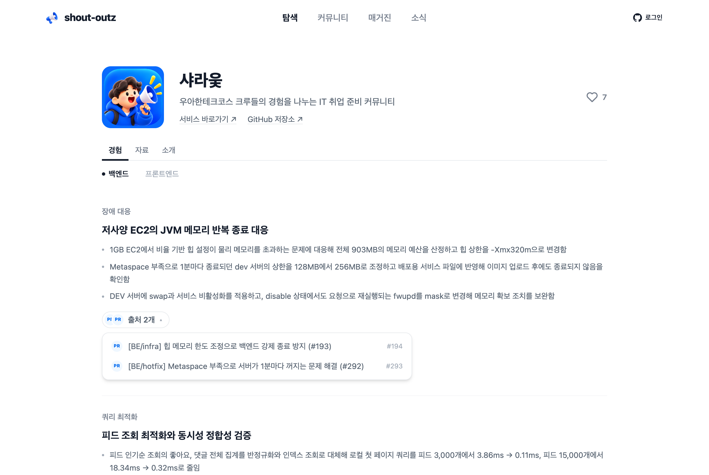
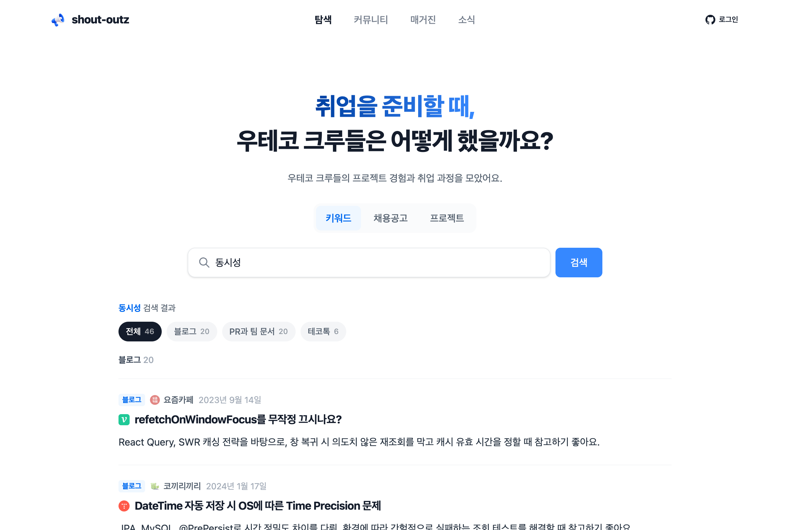
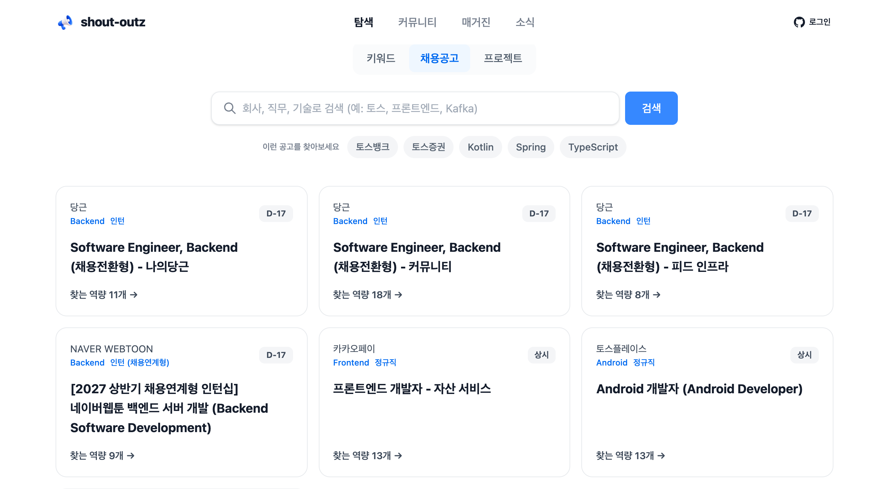
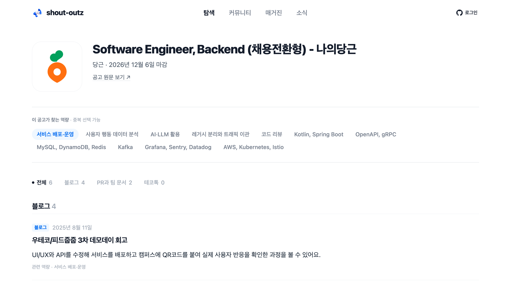
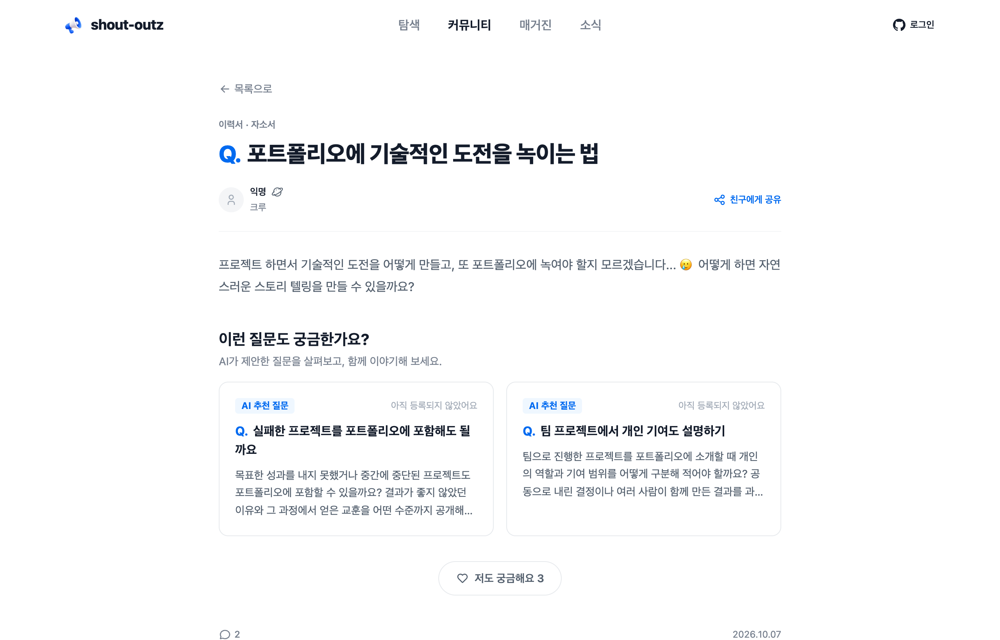
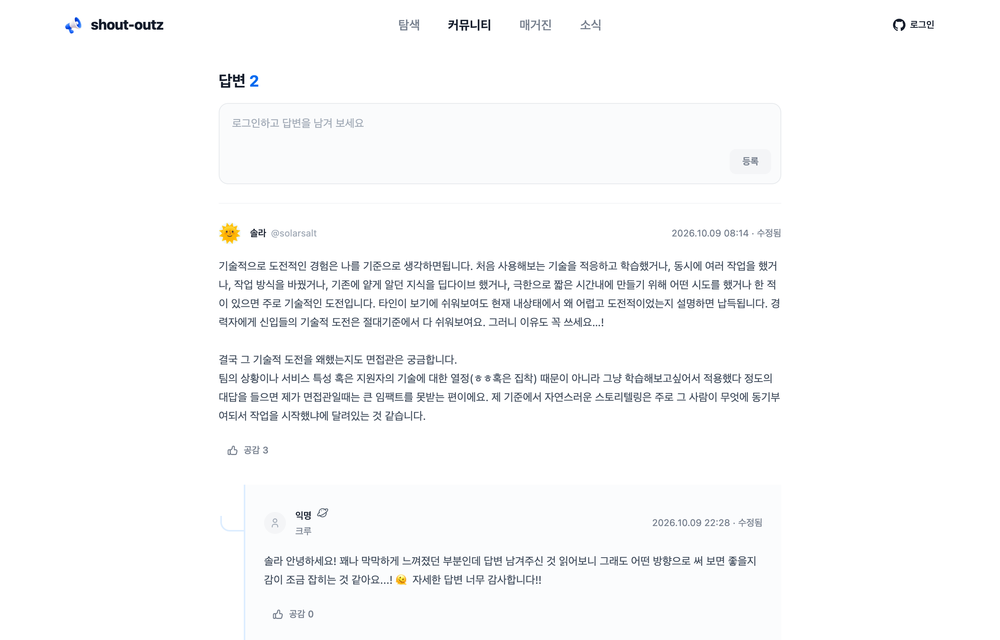
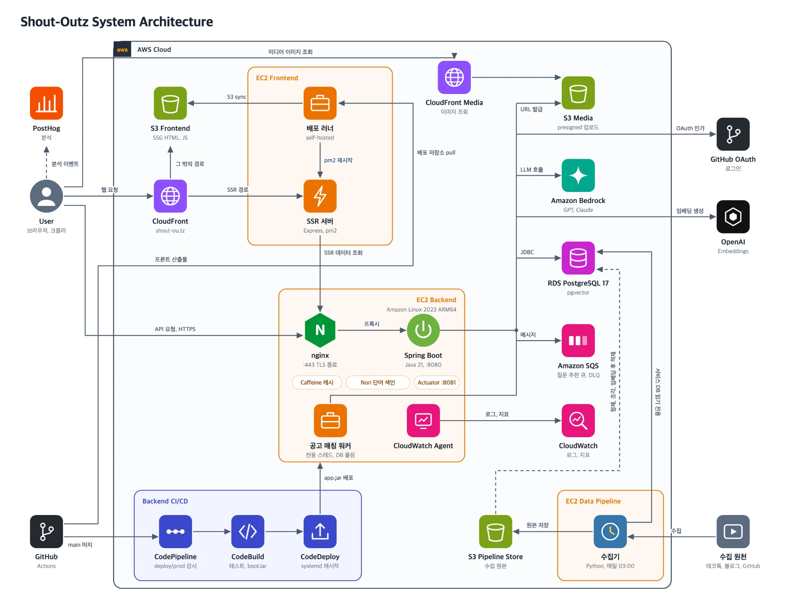

# 샤라웃

**개발자 취업 준비생들을 위한 새로운 레퍼런스** · [shout-ou.tz](https://shout-ou.tz)

> 포트폴리오나 면접을 준비하면서 감이 잘 안 잡힌 적 있지 않나요? 
> 검색은 많이 하는데, 막상 '다른 사람은 어떻게 했지?'에 대한 답은 잘 안 나와요.

 

## 샤라웃은 먼저 겪어 본 개발자들의 경험을 한곳에 모았어요

이력서, 기술, 채용 공고, 질문. 
네 가지 길로 찾아보세요.

### 이력서나 포트폴리오가 필요하다면?

프로젝트 경험을 이력서와 포트폴리오 형태로 살펴보세요. 경험마다 근거가 된 PR까지 바로 확인할 수 있어요.

### 기술로 찾아보기

실제 프로젝트에서 어떻게 파고들었는지 확인해 보세요. 블로그, PR, 테코톡을 주제로 묶고, 글마다 무엇을 배울 수 있는지 한 줄로 알려 줘요.

### 채용 공고로 찾아보기

회사가 원하는 역량별로, 관련된 경험을 찾아볼 수 있어요.

  
  

### 찾아봐도 없다면, 직접 물어보세요

질문을 남기면 먼저 겪어 본 사람들이 답해 줘요. AI가 이어서 궁금해할 만한 질문도 추천해요.

  
  

 

## 시스템 구조

 

## 기술 스택

### Frontend

| 구분 | 기술 |
|---|---|
| 언어와 화면 | TypeScript 6, React 19, TanStack Router |
| 데이터 요청 | TanStack Query 5, ky |
| 스타일 | Tailwind CSS 4 |
| 빌드와 렌더링 | webpack 5, Express(SSR), SSG |
| 테스트 | Jest 30, MSW |
| 분석 | PostHog |

### Backend

| 구분 | 기술 |
|---|---|
| 언어와 프레임워크 | Java 21, Spring Boot 4.1, Spring MVC |
| 데이터 | PostgreSQL 17, pgvector, Spring Data JPA, JdbcTemplate, Flyway |
| 검색 | pgvector(의미 검색), Lucene + Nori(키워드 검색) |
| AI | Amazon Bedrock(GPT, Claude), OpenAI Embeddings |
| 비동기 | Amazon SQS |
| 캐시 | Caffeine |
| API 문서 | Spring REST Docs, OpenAPI |
| 테스트 | JUnit 5, AssertJ, MockMvc, RestAssured |

### Data Pipeline

| 구분 | 기술 |
|---|---|
| 언어와 도구 | Python 3.12, uv |
| 저장 | Amazon S3 |

### Infrastructure & CI/CD

| 구분 | 기술 |
|---|---|
| 서버 | AWS EC2, RDS, S3, CloudFront, nginx |
| 배포 | AWS CodePipeline, CodeBuild, CodeDeploy, GitHub Actions |
| 모니터링 | CloudWatch, SNS |

 

## 저장소 구성

| 폴더 | 내용 |
|---|---|
| [`frontend`](frontend) | 웹 화면과 SSR 서버 |
| [`backend`](backend) | API 서버 |
| [`data-pipeline`](data-pipeline) | 자료 수집기 |
| [`loadtest`](loadtest) | k6 부하 테스트 스크립트 |
| [`docs`](docs) | 백엔드 ADR과 릴리스 규칙 |

 

## 팀 구성원

| [ 샤를](https://github.com/sangjun121) | [ 라이](https://github.com/dhyepark) | [ 재키](https://github.com/zzaekkii) | [ 라바](https://github.com/kojesung) | [ 클라우디](https://github.com/bel1c10ud) |
|:---:|:---:|:---:|:---:|:---:|
| Backend | Backend | Backend | Frontend | Frontend |
